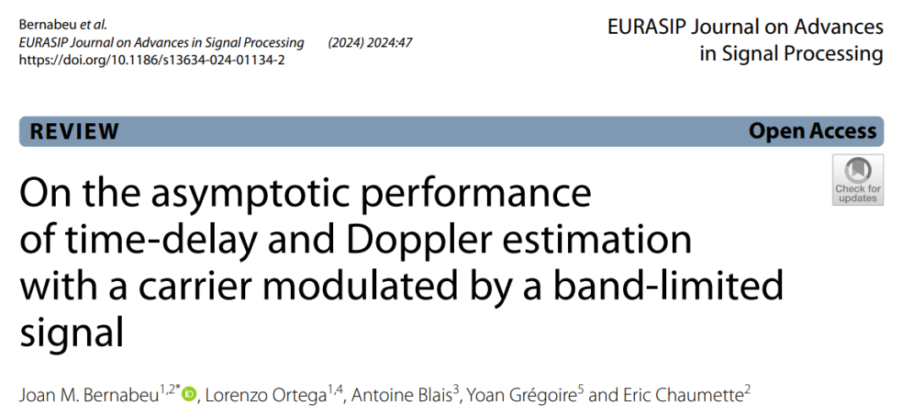
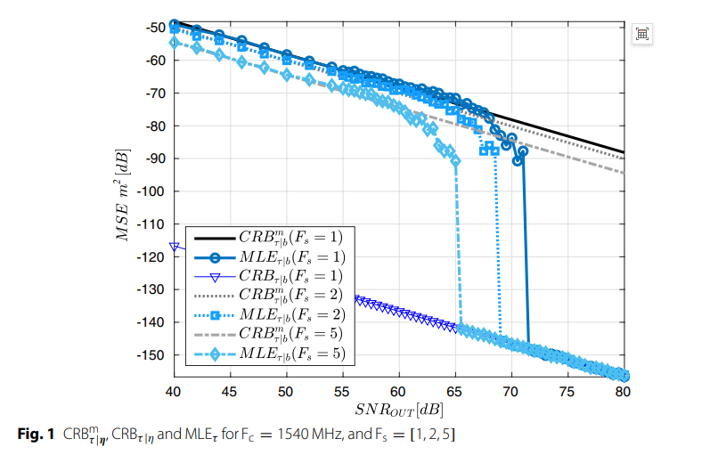
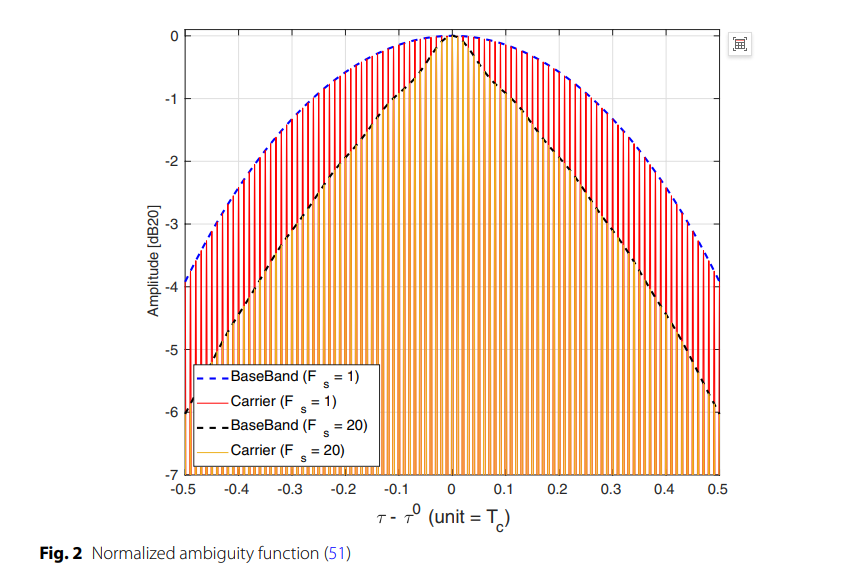
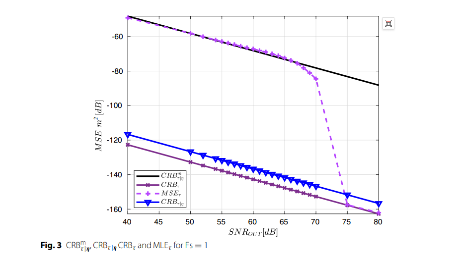
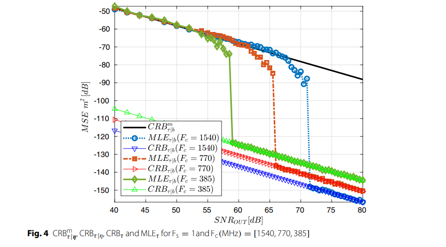
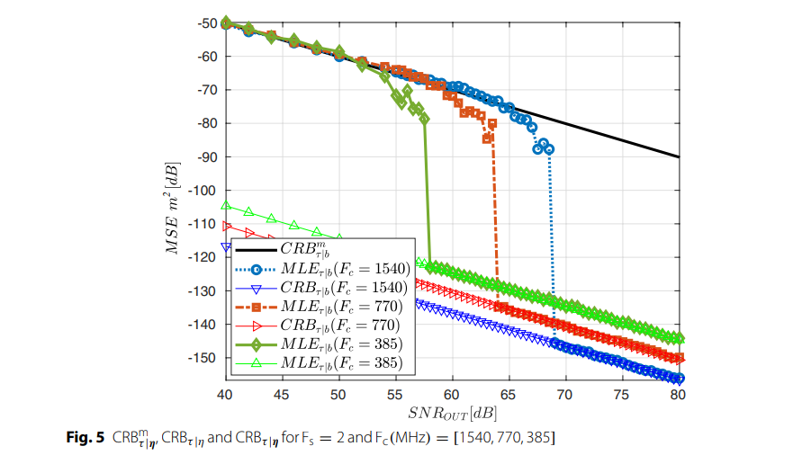
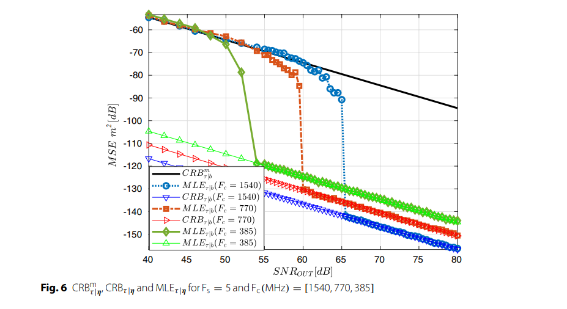

# Time-Delay Doppler Estimation Based on MLE and CRB for Limited Signal - Performance Analysis of Time-Delay and Doppler Estimation[With MATLAB Code]

Summary: Delay and Doppler Estimation are crucial in multiple engineering fields, serving as a critical initial step in the receiver operating sequence. Over the years, scholars have derived various expressions for Cramer-Rao bound (CRB) and maximum likelihood estimation (MLE). Previous research assumed that the transmission process introduces an unknown phase, hindering the explicit consideration of delay parameters within the carrier phase components in theoretical derivations. This study incorporates this additional term, thereby deriving a new maximum likelihood estimation (MLE), under the assumption of signal bandlimited. Subsequently, for the asymptotic region, closed-form expressions for the mean square error (MSE) of delay and Doppler parameters are provided under the assumption of signal bandlimited. The effectiveness of these expressions is verified through Monte Carlo simulations. The analysis reveals five distinct working regions for the maximum likelihood estimation (MLE), enriching existing knowledge and providing valuable insights into delay estimation.
Introduction: Delay and Doppler estimation occupy a key position in numerous engineering fields such as navigation, radar, reflection measurement, sonar, and communication, serving as the initial steps in the receiver operating sequence. When designing and evaluating estimation techniques for these applications, understanding the reachable performance limits in terms of mean square error (MSE) is crucial. The Cramer-Rao bound (CRB) serves as the most widely used lower bound for MSE, facilitating convenient computations across various scenarios and effectively approximating the mean square error (MSE) of the maximum likelihood estimation (MLE) in the asymptotic work region under high sample size and high signal-to-noise ratio (SNR) Gaussian conditional signal model (CSM).
In recent decades, various Cramér-Rao bound (CRB) expressions have emerged for delay and Doppler estimation problems, covering a wide range of signal types including finite narrowband signals, finite broadband signals, and even infinite bandwidth signals. Previous research has consistently assumed that unknown phase elements are introduced into the wave transmission process due to incomplete knowledge of propagation medium, transmitter and/or receiver antenna characteristics (including phase center and ultra-high frequency electronic devices), and / or radio frequency equipment. These studies often combine the phase term with the amplitude component, treating the resulting complex parameters as a single entity, leading to subsequent derivations relying on this unified parameter without explicitly accounting for the different sources of its influence.
This trend may result in gaps in existing literature regarding scenarios where unknown phase elements can be estimated and corrected, which could otherwise provide more detailed performance representations. Nowadays, in some applications, unknown phase components introduced by the wave transmission process can be calibrated at a predefined speed, ensuring their stability within the calibration interval. For example, warehouse robots in logistics use automated storage and retrieval systems (AS/RS) to navigate between known storage locations, where their position and velocity are known and can estimate and compensate for the phase components during transmission.
Based on these considerations, this paper first introduces the signal model in Section 2 as a specific instance of the Gaussian conditional signal model (CSM); Section 3 proposes a new maximum likelihood estimation (MLE); Section 4 derives closed-form expressions for the CRB based on Slepian-Boss formulas and the band-limited signal assumption; Section 5 extends the relationship between the CRB and fuzzy functions to the considered signal model; Section 6 specifically analyzes two simplified scenarios: narrowband signal models and single-parameter (delay) estimation problems with fully compensated Doppler effects; Section 7 validates the obtained CRB and MLE equations through Monte Carlo simulations; finally, Section 8 summarizes the main findings and contributions of this paper.
Methodology Introduction•
Signal Model Construction: Based on the Gaussian Conditional Signal Model (CSM), considering the transmission process of band-limited signals after carrier modulation, including the effects of time delay and Doppler shift. The expressions for the signal and related parameter definitions are clarified. It is assumed that unknown phase introduced during transmission can be calibrated and compensated. A general signal model suitable for research scenarios is established, and further deductions are made for narrowband signal models and simplified signal models under known Doppler effect with compensation.
•  
Maximum Likelihood Estimation (MLE) Derivation: Using the characteristics of the Gaussian likelihood distribution, the maximum likelihood estimation (MLE) expression is derived through minimizing the mean square error, considering parameter constraints, and clarifying the solving process and form of the MLE.
•  
Cramer-Rao Bound (CRB) Derivation: Based on the Slepian-Barsky formula, combined with the high-frequency characteristic of the signal model, the Fisher Information Matrix (FIM) is deduced, thereby obtaining the Cramer-Rao Bound (CRB) expression. Different signal models are deduced separately, clarifying the relationship between the CRB and signal parameters, carrier frequency, sampling frequency, etc.
•  
Fuzzy Function Analysis: Define fuzzy functions, analyze their correlation with the maximum likelihood estimation (MLE) and the Cramer-Rao Bound (CRB), and reveal their role in performance analysis by deriving the first and second derivatives of the fuzzy function.
•  
Simulation Verification: Design test scenarios using GPS L1 C/A signals, setting different carrier frequencies (Fc) and sampling frequencies (Fs). Through 1000 Monte Carlo simulations, verify the effectiveness of the derived maximum likelihood estimation (MLE) and Cramer-Rao Bound (CRB) expressions, analyzing the impact of carrier frequency (Fc), sampling frequency (Fs), and signal-to-noise ratio (SNR) on estimation performance.
Conclusion: This study evaluates the estimation performance of a signal model that can significantly improve the accuracy of high-precision application. For example, when the receiver moves to a predetermined path point, it can periodically measure the specific component of the received carrier phase, thereby enhancing the accuracy of time delay and Doppler estimation.
The study derives new expressions for the maximum likelihood estimation (MLE) and Cramér-Rao bound (CRB), which not only helps in understanding the performance of time delay and Doppler estimators but also provides a reference for optimal performance; meanwhile, it presents fuzzy functions, which are significant for characterizing the performance of time delay and Doppler estimators.
Simulation results verify the accuracy of the derived Cramér-Rao bound (CRB) and maximum likelihood estimation (MLE) expressions, showing that the mean square error (MSE) of the MLE converges to the CRB. In general signal models, without compensation for Doppler effects, due to the coupling between time delay and Doppler in the CRB, the accuracy of time delay estimation decreases.
The balance between carrier frequency (Fc) and sampling frequency (Fs) plays a crucial role in the convergence of the maximum likelihood estimation (MLE) to the Cramér-Rao bound (CRB): higher sampling frequency (Fs) leads to earlier convergence; reducing carrier frequency (Fc) shifts the convergence to lower signal-to-noise ratio (SNR), but worsens the level of mean square error (MSE) in the CRB.
Analysis of the fuzzy function reveals complex trade-off relationships: higher sampling frequency (Fs) narrows the baseband fuzzy function, improving time delay estimation accuracy; higher carrier frequency (Fc) narrows the carrier fuzzy function's lobes, reducing mean square error (MSE), but requires more energy to remain within the main lobe.
Unlike previous research that identified three working regions for maximum likelihood estimation (MLE), this study finds five different working regions. From an application perspective, this study provides a necessary tool for evaluating the advantages of compensating for transmission phase in time delay and Doppler estimation.
End

## Images

<!-- PAYMENT_BLOCK -->

## Get this dataset

- Payment link (Stripe): [Buy now](https://buy.stripe.com/3cs8yP7sY87d0vu9AB)
- Payment QR code: 

<!-- /PAYMENT_BLOCK -->
